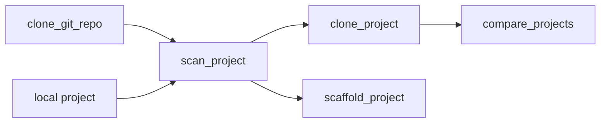

<div align="center">



A local-first [Model Context Protocol](https://modelcontextprotocol.io) server that gives Claude an Ultron-grade toolkit for understanding, cloning, and scaffolding software.


</div>

---

## Why Ultron

- **Understand first.** Scan any project and get its stack, entry points, dependencies, module blueprint, and licence.
- **Clone responsibly.** Copy local projects or fork public repos with secrets stripped and licences checked.
- **Prove it.** Compare a clone to its source and get a parity score, down to the modified file.
- **Start fast.** Scaffold a runnable Flask, Express, or static project in one call.

## Quick start

```bash
pip install -r requirements.txt
python test_core.py            # 7 core tests, no MCP SDK required
```

Register the server:

```bash
# Claude Code
claude mcp add ultron --env ULTRON_WORKSPACE=/path/to/projects -- python /path/to/ultron-mcp/server.py
```

```jsonc
// Claude Desktop: claude_desktop_config.json
{
  "mcpServers": {
    "ultron": {
      "command": "python",
      "args": ["/path/to/ultron-mcp/server.py"],
      "env": { "ULTRON_WORKSPACE": "/path/to/projects" }
    }
  }
}
```

> Local stdio servers run in Claude Code and Claude Desktop, not in the browser version of claude.ai.

## Workflow



## Tools

| Tool | What it does | Key inputs |
|---|---|---|
| `ultron_directive` | Returns the persona directive: act, think, execute, behave, clone, hard limits | none |
| `scan_project` | Stack, languages, entry points, dependencies, module blueprint, licence | `path` |
| `clone_project` | Copies a local project and writes `CLONE_NOTES.md` | `source`, `destination`, `rights_confirmed` |
| `clone_git_repo` | Shallow-clones a public https repo and reports its licence | `url`, `destination` |
| `compare_projects` | Parity %, plus missing, extra, and modified files | `source`, `clone` |
| `scaffold_project` | Runnable skeleton: `flask`, `node-express`, or `static` | `name`, `stack`, `destination`, `description` |

Also included: the prompt `ultron` (activates the persona for a task) and the resource `ultron://directive`.

## Try it

Ask Claude in plain language:

```text
Use ultron to scan my-app and summarize its stack and licence.
```
```text
Clone my-app to my-app-v2. I own it, so rights are confirmed. Then compare the two.
```
```text
Scaffold a flask project called notes-api in the workspace.
```
```text
Fork https://github.com/<owner>/<repo> into the workspace and tell me what licence it uses.
```

## Configuration

| Variable | Default | Purpose |
|---|---|---|
| `ULTRON_WORKSPACE` | `~/ultron-workspace` | Root folder. Every path must resolve inside it |
| `ULTRON_GIT_HOSTS` | `github.com,gitlab.com,bitbucket.org,codeberg.org` | Hosts allowed for `clone_git_repo` |

Relative paths are resolved against the workspace.

## Safety model

| Guard | Behavior |
|---|---|
| Workspace jail | Paths are fully resolved, symlinks included, and must stay inside `ULTRON_WORKSPACE` |
| Rights gate | `clone_project` refuses unless `rights_confirmed=true` |
| Secrets | `.env*`, `*.pem`, `*.key`, `*.p12`, `*.pfx` are never copied (`.env.example`, `.env.sample`, `.env.template` are kept) |
| Skipped by default | `.git`, `node_modules`, `venv`, `.venv`, `__pycache__`, `dist`, `build`, `.next`, `.cache`, `.idea`, symlinks |
| Git allowlist | https only, no embedded credentials, allowed hosts only, shallow clone, 5-minute timeout |
| No shell | Git runs from an argument list; nothing user-supplied is executed |
| Size limits | 5,000 files and 200 MB per project |
| Licence awareness | Detects MIT, Apache-2.0, BSD, ISC, MPL-2.0, GPL, LGPL, AGPL, Unlicense; warns on missing, unrecognized, or copyleft licences |

**Scope:** building and copying software you own or are licensed to use. No malware, self-propagating code, DRM or licence bypass, or deceptive clones.

## Project structure

```text
ultron-mcp/
├── server.py          # MCP wrapper: tools, prompt, resource
├── ultron_core.py     # All logic, standard library only
├── test_core.py       # Core tests, no SDK needed
├── requirements.txt   # mcp>=1.2.0
├── assets/
│   └── banner.svg     # README banner
└── README.md
```

## Development

`ultron_core.py` holds every behavior and has no third-party imports, so it is testable on its own. `server.py` is a thin layer that registers each core function as an MCP tool and returns expected failures as `{"error": "..."}` instead of crashing the call.

To add a tool: write the function in `ultron_core.py`, add a test, then expose it in `server.py` with `@mcp.tool()`.